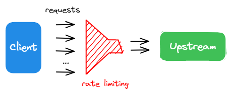

# Redis Rate Limiter

A hands-on project for learning **Rate Limiting with Redis** using the **Token Bucket algorithm**.

## What I Implemented

- Token Bucket rate limiting
- Redis for storing bucket state
- Token refill based on elapsed time
- Per-IP rate limiting
- Redis key expiration with TTL, refreshed on every request
- One atomic Lua script (`redis.defineCommand`) for refill + check + consume
- Redis `TIME` as the shared clock across replicas

## Token Bucket Configuration

```text
Bucket capacity: 5 tokens
Refill rate:     1 token / second
Key TTL:         10 seconds
```

Each IP has its own bucket:

```text
rateLimitIP:{ip}
```

The bucket state is stored as a hash:

```text
tokens  4.317           # fractional, refilled continuously
ts      1791359589828   # last update, ms from Redis TIME
```

## How It Works

```text
Request
   │
   ▼
Get or initialize bucket
   │
   ▼
Calculate elapsed time
   │
   ▼
Refill tokens
   │
   ▼
Is a token available?
   │
 ┌─┴─────────┐
 │           │
Yes          No
 │           │
 ▼           ▼
Consume     Reject
1 token
 │
 ▼
Allow
```

## Redis Operations

Everything runs inside one Lua script, so the whole read-modify-write is atomic
even with many API replicas sharing the same Redis:

```text
TIME                                   -- now, in ms
HMGET key tokens ts                    -- missing key => full bucket
tokens = min(capacity, tokens + elapsedMs * rate / 1000)
if tokens >= 1 then tokens = tokens - 1, allowed = 1
HSET key tokens <tokens> ts <now>
EXPIRE key 10                          -- refreshed on every call
return { allowed, floor(tokens) }
```

The script is registered once per client with `redis.defineCommand('tokenBucket', ...)`
and called as `redis.tokenBucket(key, capacity, rate, ttl)`. ioredis sends it with
`EVALSHA` and falls back to `EVAL` if the script is not cached yet.

## Example

Initial bucket:

```text
5 tokens
```

After one request:

```text
4 tokens
```

After 2 seconds:

```text
4 + 2 = 5 tokens
```

The bucket is capped at its maximum capacity:

```text
min(currentTokens + tokensToRefill, 5)
```

Then one token is consumed for the current request.

## Tech Stack

- Node.js
- NestJS
- TypeScript
- Redis
- ioredis

## Purpose

This project is a practical exercise to understand how **Token Bucket rate limiting works with Redis**, including token refill, bucket expiration, and Redis key operations.

## Production-like Environment

```text
k6 ──► Nginx :8080 ──► api × 3 (NestJS) ──► Redis
```

Three API replicas sit behind Nginx and share one Redis, the same shape as a real deployment. `TRUST_PROXY_HOPS=1` makes `req.ip` the real client IP instead of Nginx's. Every response carries an `X-Instance` header naming the replica that served it.

```bash
docker compose up -d --build
curl -i http://localhost:8080/        # check X-Instance and the 200/429
```

## Load Tests

| Script | What it checks | Correct limiter |
| --- | --- | --- |
| `load-test/burst.js` | 50 simultaneous requests (race condition) | ≤ 5 allowed |
| `load-test/steady.js` | 3 req/s for 30s (TTL reset) | ≤ 35 allowed |

```bash
docker compose run --rm k6 run /scripts/burst.js
docker compose run --rm k6 run /scripts/steady.js
```

A script exits non-zero (threshold failed) when the limiter lets more requests through than it should. Each script waits 11s first so the previous bucket has expired.
